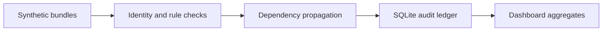

# Clinical Data Quality Engine

A reproducible pre-analytics quality gate for three synthetic clinical feeds. It identifies records that need source remediation, preserves rule-level lineage, and keeps downstream observations out of analysis when their patient or encounter was quarantined.

## The decision

A clinical data engineering lead reviewing a new feed needs two answers. Which defects should a source team fix first, and which records can downstream analytics use? A flat count of errors obscures the second question because one invalid patient can block an encounter and several observations.

The demo ran 17 automated tests and processed **1,156 synthetic entries** from **12 batches**. It accepted **1,076** and quarantined **80**. Of the quarantined entries, **52** failed a rule directly and **28** were blocked solely by a quarantined dependency. All **16** timing warnings remained eligible. The accepted set included **516** normalized measurements.

| Synthetic feed | Input entries | Accepted | Direct quarantine | Dependent-only quarantine |
| --- | ---: | ---: | ---: | ---: |
| Ambulatory | 388 | 376 | 12 | 0 |
| Community clinic | 384 | 344 | 20 | 20 |
| Virtual care | 384 | 356 | 20 | 8 |

**Operational takeaway.** The community clinic fixture shows how upstream remediation can reduce quarantine downstream. Half of that feed’s quarantines are dependency-only. The rule ledger identifies the direct failures and the affected edges, so a reviewer can address the source record first and then re-run the batch. Defect counts and rates describe the injected fixture scenarios.

## Run locally

Use Python 3.11+ with SQLite 3.30+ through the Python standard library. The CLI requires zero third-party packages and makes zero network requests. Run commands from this directory.

```sh
python3 run.py generate .work/synthetic
python3 run.py validate .work/synthetic .work/audit
python3 -m unittest discover -s tests -v
cmp outputs/report.json .work/audit/report.json
```

The generated files are `report.json` (dashboard aggregates) and `audit.sqlite3` (audit ledger and normalized accepted measurements). The included `outputs/` directory holds reference outputs from the default fixture. Run the included SQL examples with Python and the local SQLite library.

```sh
python3 - <<'PY'
import sqlite3
from pathlib import Path

with sqlite3.connect(".work/audit/audit.sqlite3") as connection:
    for statement in Path("docs/review.sql").read_text().strip().rstrip(";").split(";"):
        print(connection.execute(statement).fetchall())
PY
```

## How it works



1. Load a named synthetic FHIR R4 collection Bundle, reject ambiguous JSON, and fingerprint the received bytes.
2. Index local identities before checking rules, so source order does not determine reference resolution. Preserve an entry hash, entry offset and finding path.
3. Resolve Patient and Encounter edges locally. Check code, UCUM unit, calendar and clock fields, and agreement between an observation and its linked encounter subject.
4. Propagate quarantine in resource order, from Patient through Encounter to Observation. A single resource may have multiple findings. A warning alone leaves it eligible.
5. Store rule findings, reference edges, disposition, and eligible normalized measurements in SQLite. Query the ledger to create the aggregate JSON.

The ledger stores resource metadata and lineage digests. It omits raw FHIR payloads and identifiers. Source batches remain the evidence behind each digest and finding path. See [methods and data contract](docs/methods.md) for rule and source details and [SQL examples](docs/review.sql) for reviewer queries.

## Engineering scope

The engine evaluates a selected ingest contract for synthetic Patient, Encounter and scalar Observation data. The repository is a technical portfolio demonstration with AI-assisted implementation. Report figures come from the executed fixture and SQL queries. A real implementation would use a formal FHIR validator, implementation guide and terminology service, secure storage with access controls, workflow policies for warnings, and representative validation datasets.
