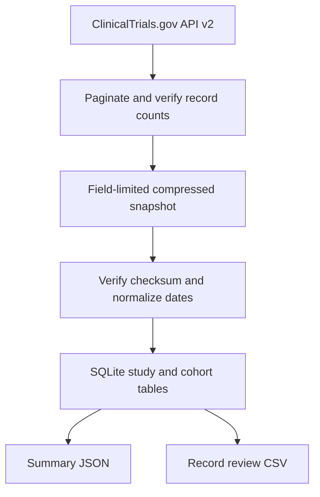

# Trial Registry Intelligence

A reproducible registry operations workbench that measures the availability and posting timing of summary results across three ClinicalTrials.gov search cohorts. The intended users are clinical research operations and registry stewardship teams that need to reconcile records and prioritize manual review.

## What the snapshot shows

ClinicalTrials.gov API v2 reported its data version as **November 10, 2026**. The three searches returned 7,154 distinct NCT identifiers. After requiring an actual primary completion date in 2018–2023, **5,524** distinct studies remained. There were 4,466 with completed status, 648 terminated, 108 withdrawn, and 302 with other statuses.

Among the 4,466 completed records, 1,264 (28.30%) had results available in this snapshot. The date-based measures found 141 known to have posted within 365 days, 1,114 after 365 days, and 9 with indeterminate timing. The remaining 3,202 had no registry results flag or posting date. Counting none versus all of the 9 indeterminate records yields a **3.16%–3.36%** sensitivity range for 365-day posting. This operational metric measures registry posting with the project’s stated denominator. A compliance assessment would require a separately defined applicable-trial cohort, submission dates, and exemptions or extensions.

| ClinicalTrials.gov search | Included | Completed denominator | Registry results available | Known posted within 365 days | Indeterminate timing |
| --- | ---: | ---: | ---: | ---: | ---: |
| Asthma | 663 | 568 | 209 | 37 | 1 |
| Breast Cancer | 2,795 | 2,059 | 571 | 59 | 4 |
| Type 2 Diabetes | 2,075 | 1,848 | 485 | 45 | 4 |
| Overall, deduplicated | 5,524 | 4,466 | 1,264 | 141 | 9 |

Eight included records match multiple search terms. The group rows can overlap and the overall row counts each NCT identifier once. Coverage differences are descriptive and could reflect the mix of phases, sponsor types, designs, jurisdictions and reporting obligations.

## Reproduce the analysis

Use Python 3.10+ with SQLite 3.30+ and no external Python dependencies. Run from this directory.

```sh
python3 src/analyze.py
python3 -m unittest discover -s tests -v
python3 src/review_queue.py --timing unknown > output/unknown_timing_review.csv
```

If you already have the original compressed snapshot, the first command verifies its checksum and regenerates `output/trials.sqlite` and `output/trials_summary.json` offline. The review command produces a traceable CSV with public NCT URLs. To filter, pass `--cohort asthma`, `--cohort breast-cancer`, or `--cohort type-2-diabetes`. Use `--timing after_365` or `--timing not_posted` for larger queues and `--limit` to control export size.

The historical compressed snapshot is not included in this public repository. To capture the current registry, use the public API.

```sh
python3 src/registry.py --snapshot data/current_registry.json.gz
python3 src/analyze.py --snapshot data/current_registry.json.gz --out-dir output/current
```

Live results can change. Keep the packaged capture and checksum together to reproduce the findings above.

## How the system works



The pipeline uses Python for deterministic capture, interval handling and validation, then SQLite for indexed membership and cohort aggregation. The SQL schema has one row per study and one row per study–cohort relationship. The front end consumes compact precomputed JSON, which avoids live requests during navigation.

The snapshot stores study-level fields for NCT ID, study type and status, primary completion, registry results presence, first-post date, sponsor class and phase. There are no patient-level records or contact fields. The compressed snapshot preserves the selected source fields, cohort memberships, data version and capture time.

See [case study](docs/CASE_STUDY.md), [data dictionary](docs/DATA.md) and [verification](docs/VERIFICATION.md).

## Provenance

MaCoi Hollins commissioned the portfolio. The implementation, analysis and tests were produced with material AI assistance. Individual contributions should be described using the portfolio’s contribution record as the work is reviewed.

Source data are from ClinicalTrials.gov and are subject to its [terms and conditions](https://clinicaltrials.gov/about-site/terms-conditions). See the [NLM API release bulletin](https://www.nlm.nih.gov/pubs/techbull/ma24/ma24_clinicaltrials_api.html) and [ClinicalTrials.gov glossary](https://clinicaltrials.gov/study-basics/glossary) for API and field context.
